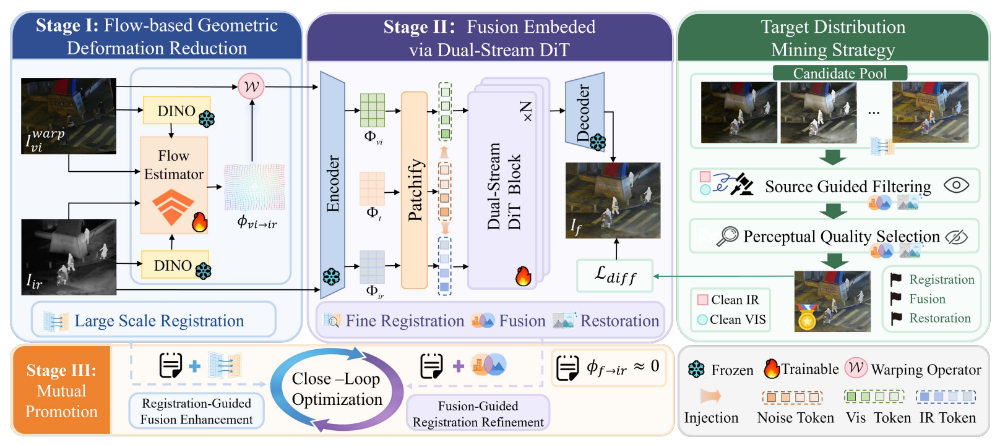

# G2Fusion：
**Geometric-to-Generative Image Fusion via Registration-Restoration Evolution**

G2Fusion addresses infrared-visible image fusion when **spatial misalignment and image degradation coexist**. It combines explicit geometric registration with conditional generative fusion to recover aligned, detailed fused images from unregistered and degraded inputs.

## Method

## Data and checkpoints

Obtain datasets from their original providers and prepare matching image pairs. The loaders pair files by **sorted path order**, so filenames, counts, and spatial dimensions must correspond across folders.

- `X`: visible images
- `Y`: infrared reference images
- `Z`: mined fusion pseudo-targets

Example folder layout, matching the YAML templates:
```text
datasets/
├── train/
│   ├── X/
│   ├── Y/
│   └── Z/
└── test/
    ├── X/
    ├── Y/
    ├── Z/
    └── X_warp/
```

## Pseudo-target selection

Prepare an aligned source pair and candidate fused images with identical filenames:

```text
candidates/
├── vis/
├── ir/
├── method_A/
└── method_B/
└── ...
```

Run from the repository root:

```bash
python select_gt/select_pipeline.py /path/to/candidates --topk 5
```

## Training


Run each of the following commands **from the repository root**; parentheses keep each stage's working directory local to that command:

```bash
# 1. Flow-GDR
(cd config/Reg && torchrun --nnodes=1 --nproc_per_node=2 \
  train_Match.py -opt options/train/train_matcher.yml --launcher pytorch)

# 2. Standalone DiT-GF
(cd config/DiT && torchrun --nnodes=1 --nproc_per_node=2 \
  train_DiT.py -opt options/train/train_DiT.yml --launcher pytorch)

# 3. Mutual promotion
(cd config/MP && torchrun --nnodes=1 --nproc_per_node=2 \
  train_DiT.py -opt options/train/train_DiT.yml --launcher pytorch)
```
## Evaluation

After configuring real data and checkpoint paths, run from the repository root:

```bash
# Flow-GDR registration evaluation
(cd config/Reg && python test_Match.py -opt options/test/test_Matcher.yml)

# Standalone DiT-GF evaluation on already registered visible/infrared inputs
(cd config/DiT && python test_DiT.py -opt options/test/test_DiT.yml)

# Combined registration and fusion using MP-compatible checkpoints
(cd config/MP && python test_DiT.py -opt options/test/test_DiT.yml)
```


## Citation

Bibliographic information below follows the supplied camera-ready paper:

```bibtex
@inproceedings{zhang2026g2fusion,
  title     = {{G2Fusion}: Geometric-to-Generative Image Fusion via Registration-Restoration Evolution},
  author    = {Zhang, Hao and Wu, Douyu and Xu, Han and Tang, Linfeng and Jin, Qiwen and Ma, Jiayi},
  booktitle = {Advances in Neural Information Processing Systems},
  year      = {2026}
}
```

## Acknowledgments

Our code is built upon the following projects. We sincerely thank the authors for their contributions.

- [OmniFuse](https://github.com/HaoZhang1018/OmniFuse)
- [DINOv3](https://github.com/facebookresearch/dinov3)
- [DiT](https://github.com/facebookresearch/DiT)
## License

This project is released under the terms of the [LICENSE](LICENSE).
